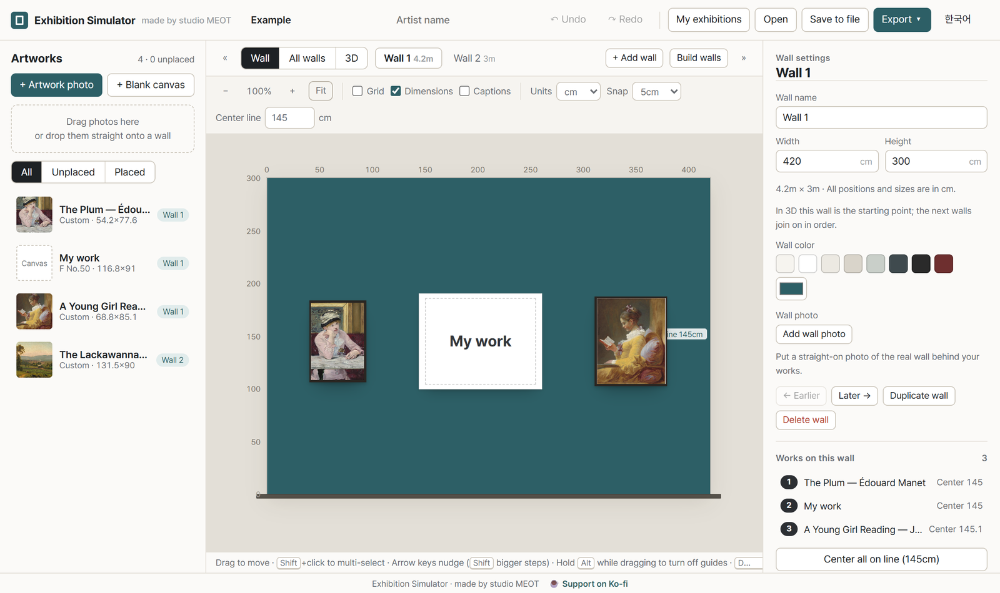
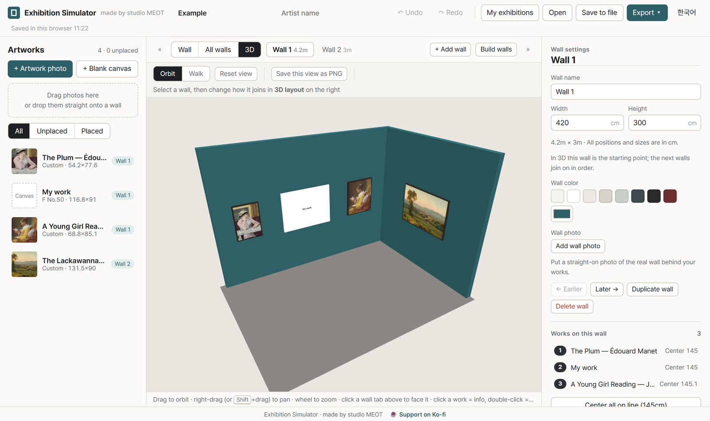

# Exhibition Simulator · 전시 시뮬레이터

Plan your artwork layout on real wall dimensions — free, no sign-up, right in your browser.
실제 벽 치수에 맞춰 작품을 미리 걸어 보세요. 무료이고, 가입 없이 브라우저에서 바로 씁니다.

**→ [Open the simulator / 바로 쓰기](https://studio-meot.github.io/exhibition-simulator/)**

---

## English

### What it does
- **Real sizes** — enter wall size and artwork size in cm (or inches) and see them to scale. Korean canvas sizes (호수, F/P/M/S) are built in.
- **Wall shapes** — build straight, L-, U- or four-wall spaces, or set each wall's length and turn yourself.
- **Spacing and height** — check gaps and center height in cm before you hang anything.
- **3D view** — look around the space from above or walk through it.
- **Placeholders** — not finished yet? Hang a blank canvas of the right size and swap in a photo later.
- **Install plan** — print it or save it as a PDF for the venue or your team.

### Privacy
- No account, no server. Everything runs in your browser.
- Your photos never leave your device. Exhibitions are saved in this browser only.

### How to use
1. Open the link above on a computer or phone.
2. Make your walls, add artworks (photo or blank canvas), and drag them into place.
3. Switch to 3D to look around, then export the install plan.

---

## 한국어

### 할 수 있는 것
- **실제 크기로** — 벽 크기와 작품 크기를 cm로 넣으면 비율 그대로 보입니다. 호수(F·P·M·S)를 고르면 크기가 바로 들어갑니다.
- **벽 모양** — 일자·ㄱ자·ㄷ자·ㅁ자를 고르거나 직접 만들 수 있습니다.
- **간격과 높이** — 작품 사이 간격과 중심 높이를 cm로 확인합니다.
- **3D 보기** — 위에서 둘러보거나 걸으면서 볼 수 있습니다.
- **빈 캔버스** — 아직 완성되지 않은 작품은 크기만 정해 자리를 잡아 두고, 나중에 사진을 넣습니다.
- **설치 도면** — 인쇄하거나 PDF로 받아 전시 공간이나 함께하는 사람에게 보여 줄 수 있습니다.

### 개인정보
- 가입도, 서버도 없습니다. 모든 것이 브라우저 안에서 돌아갑니다.
- 사진은 기기 밖으로 나가지 않습니다. 전시는 이 브라우저에만 저장됩니다.

### 쓰는 법
1. 위 링크를 컴퓨터나 휴대폰에서 엽니다.
2. 벽을 만들고, 작품(사진 또는 빈 캔버스)을 넣어 끌어다 놓습니다.
3. 3D로 둘러본 뒤 설치 도면을 내보냅니다.

---

Made by **studio MEOT** — free tools for beginner and non-major artists.

© studio MEOT. All rights reserved. The source is public so you can see how it works, but it is not licensed for reuse or redistribution.
소스는 확인할 수 있도록 공개되어 있지만, 다시 쓰거나 배포할 수 있는 라이선스는 주지 않습니다.

Example paintings in the screenshots are public-domain works from the National Gallery of Art, Washington.
스크린샷 속 예시 그림은 미국 국립미술관이 공개한 퍼블릭 도메인 작품입니다.
